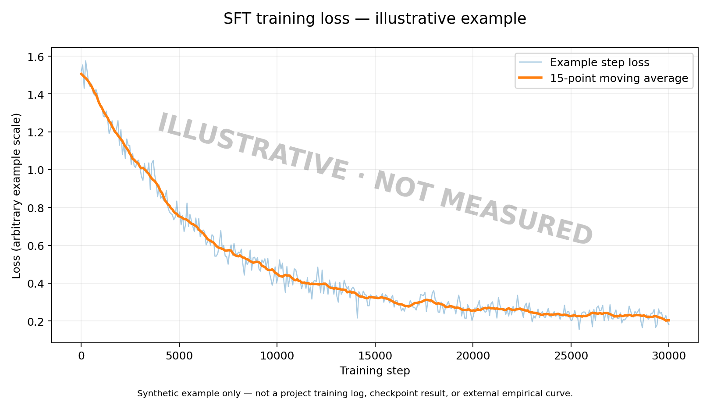
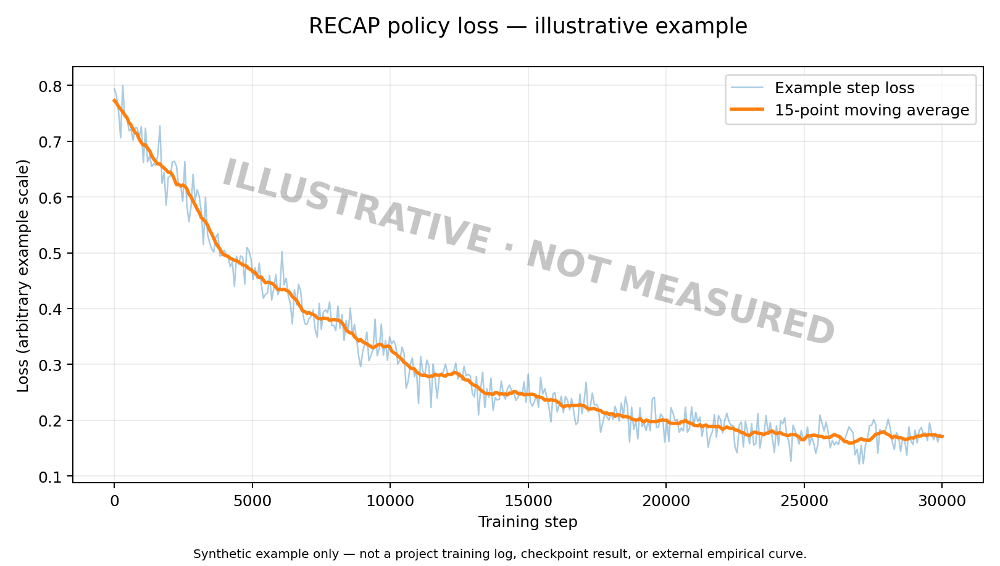

# openpi-recap-sim

基于 **π₀.₅ VLA 与 RECAP 风格优势条件策略训练**的 LIBERO 仿真闭环学习项目，覆盖专家示范微调、策略自主 Rollout、数据融合、VLM Value Model 训练、N-step Advantage 标注和策略再训练。

---

## LIBERO 仿真演示

以下视频选自仓库收录的公开参考录像，用于展示 LIBERO 任务中的成功执行与失败情况，**不是本项目模型的实测 Rollout**。

- **Success Rollout（成功案例）**：[观看 LIBERO-Spatial 成功视频]

https://github.com/user-attachments/assets/01a1c6e0-ad78-4434-b520-825568404c73


- **Failure Rollout（失败案例）**：[观看 LIBERO-Spatial 失败视频]

https://github.com/user-attachments/assets/c0f2cece-82b4-41d0-98f2-1e90db5c2aff


其余参考视频位于 [LIBERO 视频目录](outputs/libero/videos/)。

## 目录

1. [环境与目录准备](#1-环境与目录准备)
2. [闭环训练流程](#2-闭环训练流程)
3. [数据格式与字段定义](#3-数据格式与字段定义)
4. [准备 LIBERO 专家示范](#4-准备-libero-专家示范)
5. [配置 LIBERO 仿真环境](#5-配置-libero-仿真环境)
6. [初始 SFT 训练](#6-初始-sft-训练)
7. [策略服务与初始评测](#7-策略服务与初始评测)
8. [自主 Rollout 数据采集](#8-自主-rollout-数据采集)
9. [合并专家示范与 Rollout](#9-合并专家示范与-rollout)
10. [训练 VLM Value Model](#10-训练-vlm-value-model)
11. [N-step Advantage 标注](#11-n-step-advantage-标注)
12. [RECAP 风格策略再训练](#12-recap-风格策略再训练)
13. [LIBERO 对照评测与记录](#13-libero-对照评测与记录)
14. [常见问题](#14-常见问题)

## 1. 环境与目录准备

### 1.1 获取项目

```bash
git clone https://github.com/giaoleng/openpi-recap-sim.git
cd openpi-recap-sim
```

### 1.2 Python 训练环境

项目的 `pyproject.toml` 要求 Python ≥3.11。**训练主入口使用 JAX/Flax**；仓库同时保留 PyTorch 的 π₀.₅ 模型实现，另有 LeRobot、Gemma 等依赖。建议使用 `uv`，并与 MuJoCo/LIBERO 客户端环境隔离。

```bash
uv venv --python 3.11 .venv
source .venv/bin/activate
GIT_LFS_SKIP_SMUDGE=1 uv sync --active
GIT_LFS_SKIP_SMUDGE=1 uv pip install -e .
python -c "import jax, flax, torch; print('JAX:',jax.__version__,'Flax:',flax.__version__,'Torch:',torch.__version__); print('JAX devices:',jax.devices())"
```


### 1.3 模型与数据下载原则

- π₀.₅ 基础权重：上游公开的 `gs://openpi-assets/checkpoints/pi05_base`；下载至 `$WORK_ROOT/weights/pi05_base`。如平台无法连接 GCS，可使用合规镜像或已有权重副本，核对权重完整性。
- VLM Value Model 权重与 tokenizer：参考 `https://huggingface.co/ybpy/vlm_ckpt`，下载到 `$WORK_ROOT/weights/vlm_ckpt`。
- LIBERO RLDS 示范数据：`https://huggingface.co/datasets/openvla/modified_libero_rlds`。请确认实际目录结构后再填写转换参数。


## 2. 闭环训练流程

```text
LIBERO RLDS 专家示范
          │  格式转换 + value/reward/adv 标签
          ▼
     LeRobot Demo ──────────────┐
          │                     │
          ▼                     │
     π₀.₅ SFT                   │
          │                     │
          ▼                     │
  Policy Server + LIBERO        │
          │                     │
          ▼                     │
    Autonomous Rollout          │
    (成功 / 失败轨迹)            │
          │                     │
          └──── 数据合并 ◄───────┘
                    │
                    ▼
             Value Model
         学习 V(observation)
                    │
                    ▼
        N-step Advantage 估计
        + adv_ind 重新标注
                    │
                    ▼
     Advantage-conditioned SFT
                    │
                    ▼
         LIBERO 对照评测
       SFT vs. RECAP-style
```

分阶段开展：**Phase 0 环境 → Phase 1 数据 → Phase 2 SFT → Phase 3 Rollout → Phase 4 Value → Phase 5 Advantage → Phase 6 再训练 → Phase 7 评测**。先在 `libero_10` 的单个 Task 上跑通，再扩展为完整任务套件。

## 3. 数据格式与字段定义

使用 LeRobot 数据结构，至少检查以下字段：

| 字段 | 作用 | Demo / Rollout 的区别 |
| --- | --- | --- |
| `image` | 主视角 RGB 图像 | 两者均需要 |
| `wrist_image` | 腕部相机图像 | 两者均需要 |
| `state` | 机器人状态 | 两者均需要 |
| `actions` | 动作监督目标 | 两者均需要 |
| `intervention` | 是否为示范/人工干预帧 | Demo 为 1，自主 Rollout 为 0 |
| `value_label` | Value Model 的监督标签 | 由成功/失败及时间步规则生成 |
| `reward` | 稀疏任务奖励 | 成功轨迹通常末帧为 1 |
| `reward_label` | 用于 N-step Advantage 的奖励信号 | 按轨迹规则构造 |
| `adv_ind` | 优势条件 `positive` / `negative` / `none` | Demo 通常 positive，Rollout 初始为 none |

此外还需要 `timestamp`、`frame_index`、`episode_index`、`index` 和 `task_index` 等索引字段。**合并脚本不会自动补列、补奖励或修改图像布局**，不同来源的数据必须先对齐。

对于一条长度为 `T` 的成功 Demo，当前转换脚本的主要标签规则为：

```text
intervention = 1
adv_ind = positive
value_label(t) = -(T - 1 - t) / T
reward(t) = 1 (仅最后一帧), 否则 0
reward_label(t) = -1/T (非终止帧), 最后一帧为 0
```


## 4. 准备 LIBERO 专家示范

### 4.1 转换 RLDS → LeRobot

先将公开的 LIBERO RLDS 数据下载/解压至 `$WORK_ROOT/raw_libero_rlds`，确认其中包含 `libero_10_no_noops`、`libero_goal_no_noops`、`libero_object_no_noops`、`libero_spatial_no_noops` 的相关数据目录，然后在**训练环境**运行：

```bash
python examples/libero/pistar_rlds_demo_processing.py \
  --data_dir "$WORK_ROOT/raw_libero_rlds" \
  --output_dir "$WORK_ROOT/lerobot_datasets" \
  --repo_name libero_demo
```

> 转换脚本的 `--overwrite` 默认为 true，会删除同名既有输出目录。首次运行前先确认路径，避免覆盖数据。每个任务的真实 Episode 数以转换日志为准。

### 4.2 检查结果

```bash
ls "$WORK_ROOT/lerobot_datasets/libero_demo"
find "$WORK_ROOT/lerobot_datasets/libero_demo/meta" -maxdepth 1 -type f
```


## 5. 配置 LIBERO 仿真环境

```bash
cd "$PROJECT_ROOT"
git clone https://github.com/Lifelong-Robot-Learning/LIBERO.git third_party/libero
git -C third_party/libero rev-parse HEAD  # 记录当前 checkout 的 SHA
# 真正复现已完成实验时，请使用实际实验的 LIBERO commit：
# git -C third_party/libero checkout <实际实验的 LIBERO_COMMIT>

uv venv --python 3.10 .venv-libero
source .venv-libero/bin/activate
uv pip install -e packages/openpi-client
uv pip install -e third_party/libero
uv pip install --no-deps git+https://github.com/huggingface/lerobot@0cf864870cf29f4738d3ade893e6fd13fbd7cdb5
export PYTHONPATH="$PROJECT_ROOT/third_party/libero:$PYTHONPATH"
export MUJOCO_GL=egl
export PYOPENGL_PLATFORM=egl
```

**依赖注意：** 上述 Python 3.10 手动安装方案是本项目的首选参考；正式实验的精确版本以私有环境记录为准。新增的 `examples/libero/Dockerfile` 采用 Python 3.10 和同一 LeRobot 源码版本，作为容器化准备方案；旧 Python 3.8 / CUDA 11.3 方案保留为 `examples/libero/Dockerfile.legacy`，**不再作为推荐安装方式**。`examples/libero/requirements.txt` 是旧环境的依赖清单，请勿混入 Python 3.10 环境。

若选择 Docker，必须先在项目根目录克隆并检出实际实验对应的 `third_party/libero` 版本（仓库不跟踪该目录），再从仓库根目录执行：

```bash
docker build -f examples/libero/Dockerfile -t openpi-libero-py310 .
```

Docker 中 LeRobot 会解析其声明的依赖，而手动安装示例使用 `--no-deps`（适用于依赖已齐全的环境）；两种方式都不应被误认为是对私有正式实验环境的完整锁定复现。本次只修改构建脚本，**未执行 Docker build 或 GPU 运行**。完整依赖版本与外部 LIBERO commit 尚未在本仓库公开。

不加载策略模型的环境检查示例：

```bash
python examples/libero/main.py \
  --args.debug_raw_obs_only true \
  --args.debug_task_id 0 \
  --args.debug_num_steps 5
```

检查环境 reset/step、原始 RGB 图像导出和 EGL/图形库加载。若 EGL 在指定容器不可用，可以按所用图形环境排查，必要时评估 Xvfb/GLX 方案；这与“项目已经完成实验”的状态并不矛盾。

## 6. 初始 SFT 训练

**切回训练环境：**

```bash
cd "$PROJECT_ROOT"
source .venv/bin/activate
```

### 6.1 核对训练配置

现在推荐使用仓库已有的 **`scripts/libero_pipeline.py`** 统一入口。它在运行时覆盖上游 `config.py` 中的默认数据集标识和基础权重等字段，不需要直接修改该源码。

```bash
export SFT_DATA_ROOT="$WORK_ROOT/lerobot_datasets/libero_demo"
export SFT_REPO_ID="local/libero_demo"
export PI05_BASE="$WORK_ROOT/weights/pi05_base"

python scripts/libero_pipeline.py train --stage sft \
  --dataset-root "$SFT_DATA_ROOT" --repo-id "$SFT_REPO_ID" \
  --init-checkpoint "$PI05_BASE" --exp-name sft_smoke \
  --batch-size 4 --num-train-steps 5 --save-interval 5 --dry-run
```

`--dry-run` 只显示配置，不读取数据或加载模型。需确保数据格式、逻辑 repo ID 和权重参数树与真实训练一致。

### 6.2 归一化统计

```bash
python scripts/libero_pipeline.py norm --stage sft \
  --dataset-root "$SFT_DATA_ROOT" --repo-id "$SFT_REPO_ID"
```

检查归一化资产、机器人 state/action 维度及单位，避免训练/推理使用不同的 repo ID。

### 6.3 SFT 启动

```bash
XLA_PYTHON_CLIENT_PREALLOCATE=false \
python scripts/libero_pipeline.py train --stage sft \
  --dataset-root "$SFT_DATA_ROOT" --repo-id "$SFT_REPO_ID" \
  --init-checkpoint "$PI05_BASE" --exp-name sft_smoke \
  --batch-size 4 --num-train-steps 5 --save-interval 5
```

## 7. 策略服务与初始评测

### 7.1 启动策略服务（训练环境）

```bash
source "$PROJECT_ROOT/.venv/bin/activate"
python scripts/libero_pipeline.py serve --stage sft \
  --repo-id "$SFT_REPO_ID" \
  --checkpoint "/实际路径/SFT_训练输出/实际step目录" --port 8000

### 7.2 启动客户端评测（另一个终端，LIBERO 环境）

```bash
source "$PROJECT_ROOT/.venv-libero/bin/activate"
export PYTHONPATH="$PROJECT_ROOT/third_party/libero:$PYTHONPATH"
export MUJOCO_GL=egl

python examples/libero/main.py \
  --args.host 127.0.0.1 \
  --args.port 8000 \
  --args.adv_ind_input positive \
  --args.task_suite_name libero_10 \
  --args.task_ids 0 \
  --args.num_trials_per_task 5 \
  --args.seed 7
```

## 8. 自主 Rollout 数据采集

确保策略服务仍在运行，使用同一客户端脚本开启 LeRobot 保存功能：

```bash
python examples/libero/main.py \
  --args.host 127.0.0.1 \
  --args.port 8000 \
  --args.adv_ind_input positive \
  --args.task_suite_name libero_10 \
  --args.task_ids 0 \
  --args.num_trials_per_task 10 \
  --args.save_lerobot_rollout true \
  --args.rollout_output_dir "$WORK_ROOT/lerobot_datasets" \
  --args.rollout_repo_id libero_rollout_round1
```

## 9. 合并专家示范与 Rollout

```bash
source "$PROJECT_ROOT/.venv/bin/activate"
python scripts/merge_datasets.py \
  --sources \
    "$WORK_ROOT/lerobot_datasets/libero_demo" \
    "$WORK_ROOT/lerobot_datasets/libero_rollout_round1" \
  --output "$WORK_ROOT/lerobot_datasets/libero_mixed_round1"
```


## 10. 训练 VLM Value Model

Value Model 从图像与任务信息学习 `V(o_t)`，监督来源为 `value_label`。它用于给自主 Rollout 排序/打标签，**不是 LIBERO 环境的任务成功判定器**。

先确认 Gemma tokenizer 文件存在，以及 Value 基础权重与模型配置兼容；优先使用小 batch 的短跑测试：

```bash
python scripts/train_value.py \
  --data_dir "$WORK_ROOT/lerobot_datasets/libero_mixed_round1" \
  --checkpoint_dir "$WORK_ROOT/checkpoints/value_model/round1_smoke" \
  --batch_size 4 \
  --num_train_steps 5 \
  --save_interval 5 \
  --val_interval 0 \
  --wandb_mode disabled \
  --load_pretrained \
  --tokenizer_path "$WORK_ROOT/weights/vlm_ckpt/tokenizer.model"
```

## 11. N-step Advantage 标注

算法使用 Value Model 对 Rollout 估计 `V_t`，结合 `reward_label` 计算 N-step Advantage：

```text
A_t = Σ_{k=0}^{N-1} r_(t+k) + V_(t+N) − V_t
```

其中跨 Episode 或临近结束时的边界处理应以脚本实现为准。再按 Advantage 分位数划分 `positive` / `negative` 标签，示范或干预帧通常保留 `positive`。

**重要：此步骤会修改数据集，先复制一份**：

```bash
cp -a "$WORK_ROOT/lerobot_datasets/libero_mixed_round1" \
      "$WORK_ROOT/lerobot_datasets/libero_mixed_round1_labeled"
```

配置好可用的 Value Checkpoint 后执行：

```bash
python scripts/label_advantage_from_vlm.py \
  --data_dir "$WORK_ROOT/lerobot_datasets/libero_mixed_round1_labeled" \
  --checkpoint_dir "$WORK_ROOT/checkpoints/value_model/round1" \
  --tokenizer_path "$WORK_ROOT/weights/vlm_ckpt/tokenizer.model" \
  --batch_size 8 \
  --lookahead 50 \
  --top_percent 30
```

## 12. RECAP 风格策略再训练
初始化权重应来自 SFT，而不是重新加载基础模型。

```bash
export RECAP_DATA_ROOT="$WORK_ROOT/lerobot_datasets/libero_mixed_round1_labeled"
export RECAP_REPO_ID="local/libero_mixed_round1_labeled"
export SFT_STEP="/实际路径/SFT_训练输出/实际step目录"

python scripts/libero_pipeline.py norm --stage recap \
  --dataset-root "$RECAP_DATA_ROOT" --repo-id "$RECAP_REPO_ID"

python scripts/libero_pipeline.py train --stage recap \
  --dataset-root "$RECAP_DATA_ROOT" --repo-id "$RECAP_REPO_ID" \
  --init-checkpoint "$SFT_STEP" --exp-name recap_smoke \
  --batch-size 4 --num-train-steps 5 --save-interval 5
```


## 13. LIBERO 对照评测与记录

使用相同的任务、seed、Episode 数、相机与动作设置对比：

- **Baseline**：第 6 节 SFT Checkpoint。
- **RECAP-style**：第 12 节训练的 Checkpoint。
- **Task Suites**：`libero_spatial`、`libero_object`、`libero_goal`、`libero_10`（每套件 10 个任务）。
- **成功率**：`SR = 成功 Episode 数 / 评测 Episode 总数 × 100%`。
- **汇总**：先算各套件平均，再算四套件宏平均；保留每任务统计，不只留一个总数。

| 任务套件 | π₀.₅ SFT | SFT + RECAP 风格训练 | 提升 |
| --- | ---: | ---: | ---: |
| LIBERO-Spatial | 85.0% | 89.0% | +4.0 pp |
| LIBERO-Object | 88.0% | 91.0% | +3.0 pp |
| LIBERO-Goal | 84.0% | 88.0% | +4.0 pp |
| LIBERO-10 | 68.0% | 77.0% | +9.0 pp |
| **四套件宏平均** | **81.25%** | **86.25%** | **+5.0 pp** |


### 训练过程可视化

**π₀.₅ SFT Training Loss**



*注：示意数据，非实际训练日志。*

**RECAP Policy Training Loss**



*注：示意数据，非实际训练日志。*

### LIBERO 评测配置

评测协议采用四个 LIBERO 任务套件，每套件包含 10 个任务。建议每任务运行 50 个 Episode，并使用固定初始 Seed 7。SFT 和 RECAP 分别加载对应训练阶段的 Checkpoint，以一致的评测设置进行对照。

详细参数见 [eval_config.yaml](results/evaluation/eval_config.yaml)。

## 14. 常见问题

| 问题 | 处理思路 |
| --- | --- |
| 找不到 `pistar_requirements.txt` | 本仓库按 `pyproject.toml` 安装；不要直接引用不存在的依赖文件 |
| 训练配置仍读取旧数据集 | 优先通过 `scripts/libero_pipeline.py` 的 `--dataset-root` 与 `--repo-id` 显式覆盖；使用旧入口时才检查 `config.py` 默认值 |
| GCS / Hugging Face 下载失败 | 将权重放在远程共享存储，检查 `weight_loader`、tokenizer 路径和文件完整性 |
| `ModuleNotFoundError: libero` | 安装 LIBERO，检查 `third_party/libero` 及 `PYTHONPATH` |
| EGL / MuJoCo 渲染失败 | 检查驱动、EGL 库和容器图形设备；必要时验证 Xvfb + GLX |
| `KeyError: actions` | 核查 LeRobot schema；Value 数据加载不应错误地请求动作序列 |
| Value 模型在 step 0 崩溃 | 先查主机 RAM、JAX 设备、Gemma tokenizer、模型权重和依赖版本 |
| Rollout 仍是 `adv_ind=none` | 正常的初始状态；须执行第 11 节的 Advantage 重标注 |
| RECAP 没有提升 | 查 Value 过拟合、标签分布、数据不平衡、Checkpoint 一致性与评测方差 |

项目许可证 [LICENSE](LICENSE)。
